# Inventario de vistas de la consola (14 de octubre de 2026)

Base para rediseñar la consola de Fiscal. (`frontend/`, Next.js). Para cada vista se lista para qué sirve, qué
datos usa, sus elementos en orden, las acciones, los estados (carga, vacío, error) y cómo se ve en el celular. Al
final van los componentes que se repiten y los problemas de diseño, ordenados por impacto.

- **Capturas:** en [`05-consola-vistas/`](05-consola-vistas/), a 1440 px (escritorio) y 390 px (celular), página
  completa y tema claro. Se tomaron con Playwright sobre `next dev` y **solo con datos de ejemplo** (los de
  `frontend/e2e/fixtures.ts`), nunca con datos reales de un comercio.
- **Incluye** el panel «Paso a producción» de la ficha del emisor, que llega con el PR #27.
- **Usuarios:** operadores de ProjectApp (rol administrador u operador). No hay registro abierto: los crea un
  administrador. Los comercios no entran a esta consola; usan Waiter.

## Índice

| # | Vista | Ruta | Sesión |
|---|---|---|---|
| 1 | [Iniciar sesión](#1-iniciar-sesión) | `/sign-in` | No |
| 2 | [Restablecer contraseña](#2-restablecer-contraseña) | `/forgot-password` | No |
| 3 | [Inicio](#3-inicio) | `/` | — |
| 4 | [Tablero](#4-tablero) | `/dashboard` | Sí |
| 5 | [Documentos](#5-documentos) | `/documents` | Sí |
| 6 | [Detalle del documento](#6-detalle-del-documento) | `/documents/[id]` | Sí |
| 7 | [Emisores](#7-emisores) | `/issuers` | Sí |
| 8 | [Ficha del emisor](#8-ficha-del-emisor) | `/issuers/[id]` | Sí |
| 9 | [Inscribir un emisor](#9-inscribir-un-emisor-asistente) | `/onboarding` | Sí |
| 10 | [Contingencias](#10-contingencias) | `/contingencies` | Sí |
| 11 | [Alertas](#11-alertas) | `/alerts` | Sí |
| 12 | [Sistemas cliente](#12-sistemas-cliente) | `/client-systems` | Sí |
| — | [Marco común](#marco-común) | todas | — |

Una vista con sesión, abierta sin sesión, manda a `/sign-in` (`useRequireAuth`). Una ruta que no existe muestra la
página 404 por defecto de Next.js, sin diseño propio.

---

## Marco común

| Pieza | Contenido | Archivo |
|---|---|---|
| Encabezado fijo | Logo «Fiscal.» (enlace a `/`). Con sesión: menú Tablero · Documentos · Emisores · Contingencias · Alertas · Sistemas cliente. A la derecha: idioma (ES/EN), tema (claro, oscuro, sistema) y «Cerrar sesión»; sin sesión, «Iniciar sesión» | `components/layout/Header.tsx` |
| Pie | «© 2026 Fiscal. Consola interna de facturación electrónica de ProjectApp.» | `components/layout/Footer.tsx` |
| Banner de staging | Franja con la fase del ambiente y pantalla de bloqueo cuando vence (de la plantilla) | `components/staging/*` |
| Carga | Texto «Cargando…» | `components/console/ConsoleStatus.tsx` |
| Error de carga | Recuadro con borde rojo, mensaje y «Reintentar» | `components/console/ConsoleStatus.tsx` |
| Etiqueta de estado | Píldora de color por estado del documento: gris en cola, azul transmitiendo, verde validado, rojo rechazado, ámbar en contingencia | `components/console/ConsoleStatus.tsx` |
| Colores | Tokens OKLCH claro/oscuro: primario (azul genérico de la plantilla), secundario, terciario, éxito, aviso, error, info | `app/globals.css` |
| Tipografía | Ubuntu Bold solo en el logo; el resto, la fuente del sistema. Títulos de página en 3xl seminegrita; títulos de tarjeta en lg | — |
| Ancho | Contenido a 6xl (1152 px) centrado; acceso a md; asistente a 3xl | — |
| Idiomas | Español (por omisión) e inglés, en `messages/es.json` y `messages/en.json` | — |

**En el celular:** el menú baja a una segunda fila que se desplaza de lado; a 390 px se ven Tablero, Documentos,
Emisores y Contingencias, y Alertas y Sistemas cliente quedan fuera de la pantalla.

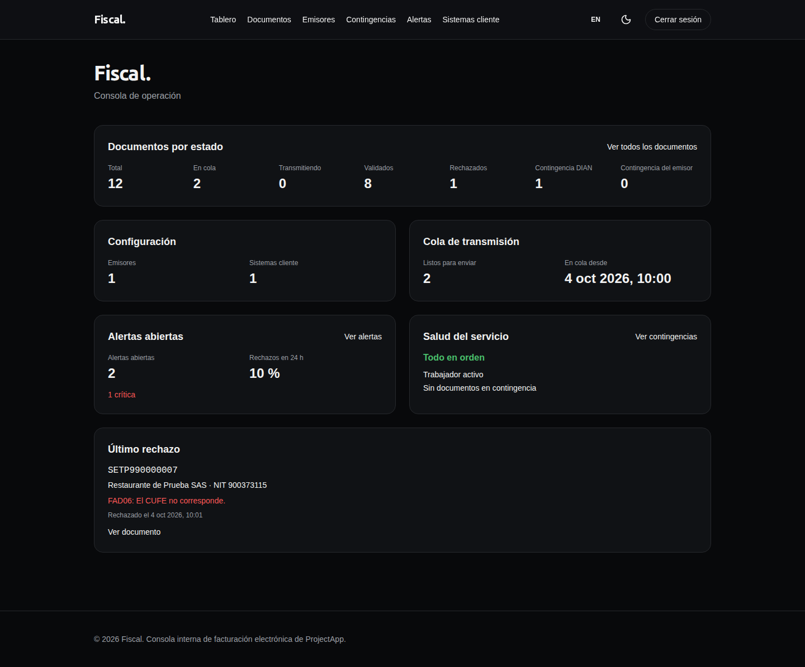

---

## 1. Iniciar sesión

**Para qué:** entrar a la consola. **API:** `POST /api/sign_in/`, `GET /api/google-captcha/site-key/`.

| Elemento | Detalle |
|---|---|
| Tarjeta centrada | Título «Iniciar sesión» y subtítulo «Entra con tu cuenta para operar la consola.» |
| Correo electrónico | Campo con el nombre solo como texto de ayuda dentro del campo (la etiqueta es invisible) |
| Contraseña | Igual |
| reCAPTCHA | Solo si el backend entrega una clave de sitio |
| «Iniciar sesión» | Botón primario de ancho completo; dice «Iniciando sesión…» mientras espera |
| Error | Texto rojo bajo el botón: «Credenciales inválidas.» o el mensaje del backend |
| «¿Olvidaste tu contraseña?» | Enlace a `/forgot-password` |

Al entrar va a `/dashboard`. El encabezado muestra también un botón «Iniciar sesión», que sobra en esta página.

| Escritorio | Celular |
|---|---|
| 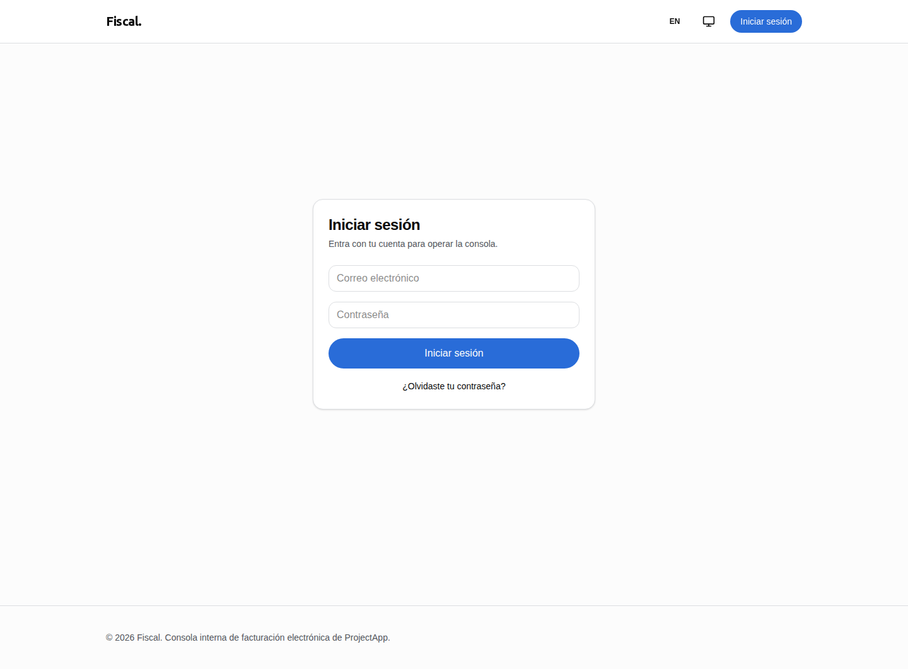 | 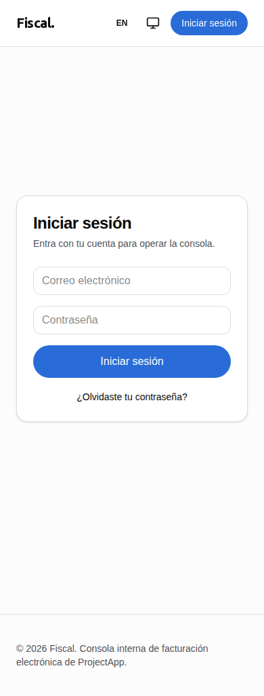 |

## 2. Restablecer contraseña

**Para qué:** cambiar la contraseña con un código enviado al correo. **API:** `POST /api/send_passcode/`,
`POST /api/verify_passcode_and_reset_password/`.

| Paso | Elementos |
|---|---|
| 1 · Correo | Texto «Escribe tu correo y te enviaremos un código…», campo de correo, «Enviar código» |
| 2 · Código | Texto con el correo en negrita, código de 6 dígitos (centrado y grande), contraseña nueva («Mínimo 8 caracteres»), confirmación, «Restablecer contraseña», «Volver al correo» |
| Siempre | «Volver a iniciar sesión»; mensajes en verde (código enviado, contraseña cambiada) o en rojo (no coinciden, muy corta, código inválido) |

Al terminar redirige al ingreso. Los campos usan otra forma (esquinas menos redondeadas) que los de «Iniciar sesión».

| Escritorio | Celular |
|---|---|
| 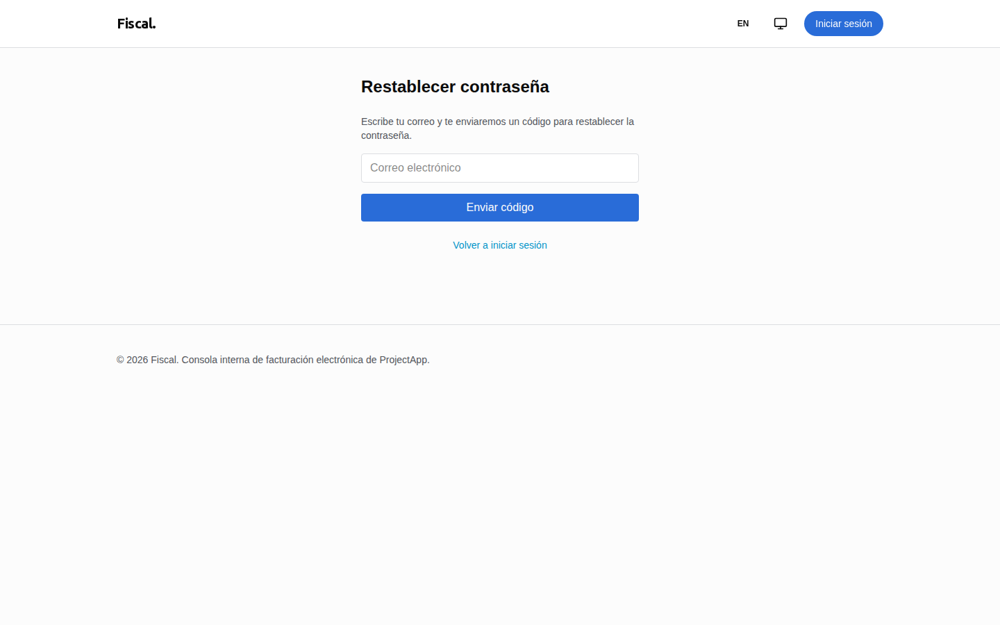 | 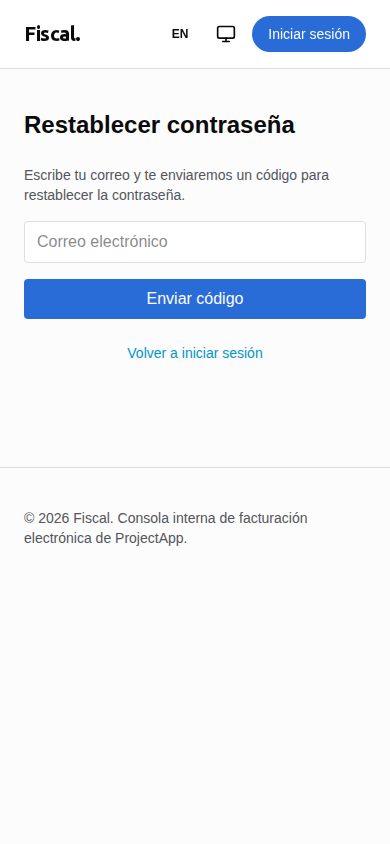 |

## 3. Inicio

Solo redirige: al tablero con sesión, al ingreso sin ella. Mientras tanto muestra «Redirigiendo…».

## 4. Tablero

**Para qué:** ver de un vistazo si el servicio está sano y si hay algo que atender. **API:** `GET /api/console/summary/`.

| Bloque | Contenido | Enlace |
|---|---|---|
| Título | El logo «Fiscal.» en grande y «Consola de operación» | — |
| Documentos por estado | 7 contadores: total, en cola, transmitiendo, validados, rechazados, contingencia DIAN, contingencia del emisor | «Ver todos los documentos» |
| Configuración | Emisores y sistemas cliente | — |
| Cola de transmisión | Listos para enviar; en cola desde (fecha y hora) | — |
| Alertas abiertas | Cuántas hay; «N críticas» (rojo si hay); tasa de rechazos en 24 h (o «—» y «Sin respuestas de la DIAN en 24 h») | «Ver alertas» |
| Salud del servicio | «Todo en orden» (verde), «Con problemas» o «Caído» (rojo); trabajador activo o «El trabajador no responde»; documentos en contingencia | «Ver contingencias» |
| Último rechazo | Solo si hay: número, emisor y NIT, primera regla de la DIAN en rojo, fecha | «Ver documento» |

- **Disposición:** tarjeta de documentos a lo ancho; debajo, dos filas de dos tarjetas (una columna en el celular).
- **Vacío:** si no hay documentos, la tarjeta de contadores se cambia por «Todavía no hay documentos».
- **Error:** recuadro de error de carga con «Reintentar».

| Con datos | Vacío | Error |
|---|---|---|
| 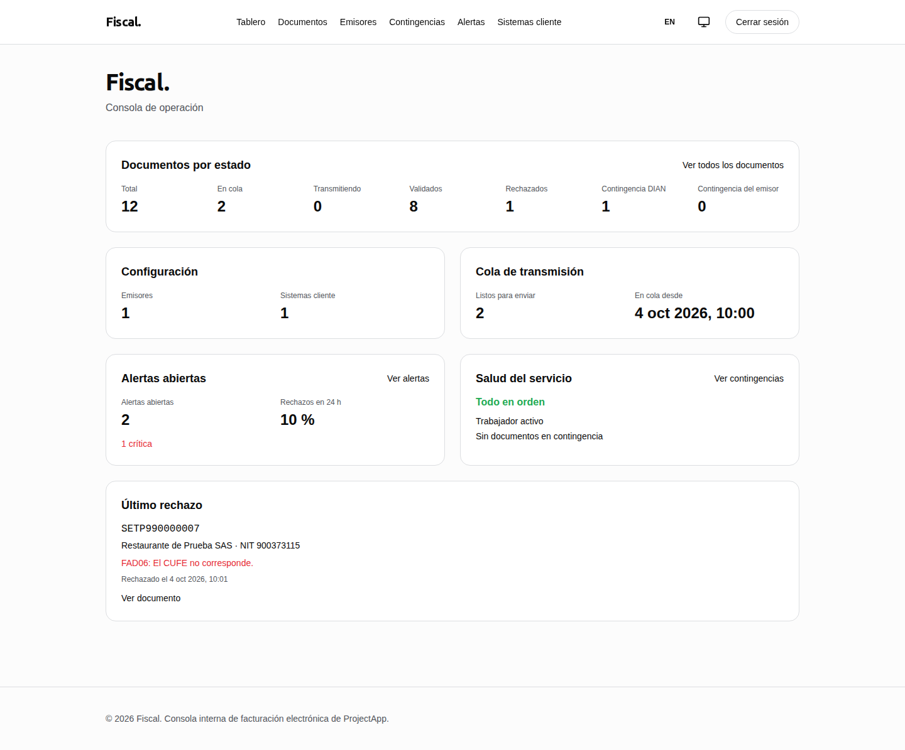 | 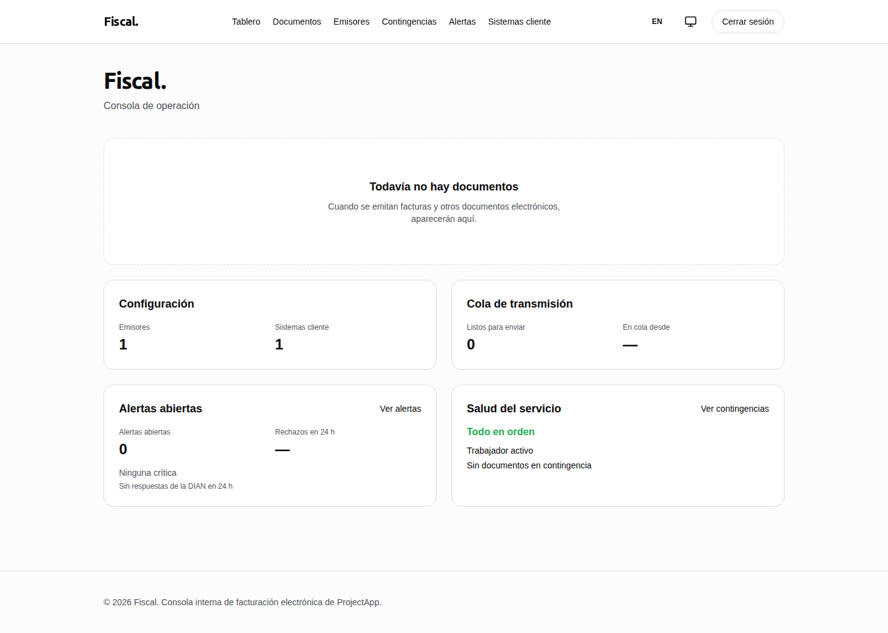 | 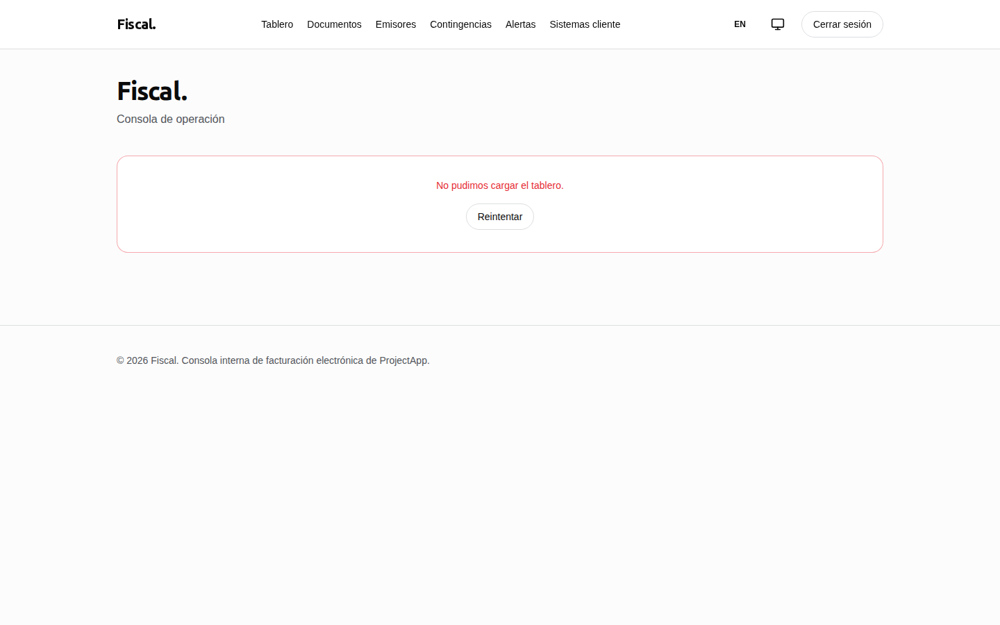 |

Celular: [con datos](05-consola-vistas/03-dashboard-mobile.png) · [vacío](05-consola-vistas/03b-dashboard-empty-mobile.png).

## 5. Documentos

**Para qué:** buscar facturas y notas de todos los emisores. **API:** `GET /api/console/documents/?state=&issuer=&page=`
(25 por página).

| Elemento | Detalle |
|---|---|
| Título | «Documentos» |
| Filtros | Estado (lista: todos y los 6 estados), NIT del emisor (texto), botón «Filtrar». Los filtros no quedan en la URL |
| Tabla (9 columnas) | Número (monoespaciado, enlace al detalle) · Tipo · Emisor (nombre y NIT debajo) · Sistema cliente · Estado (etiqueta de color) · Intentos · Emitido · Creado · Validado |
| Paginación | «Página N · M documentos», «Anterior» y «Siguiente» |
| Vacío | «No hay documentos con esos filtros.» en recuadro punteado |

**En el celular:** la tabla se desplaza de lado y a 390 px solo se ven Número, Tipo y Emisor; el estado queda fuera
de la pantalla.

| Escritorio | Celular | Vacío |
|---|---|---|
| 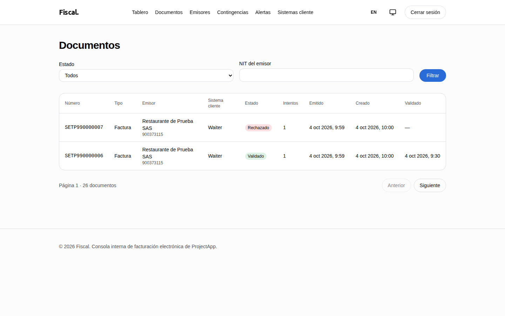 | 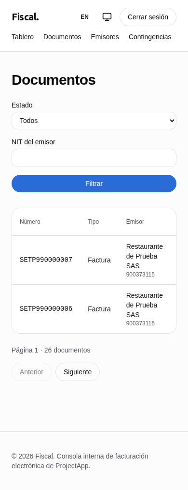 | 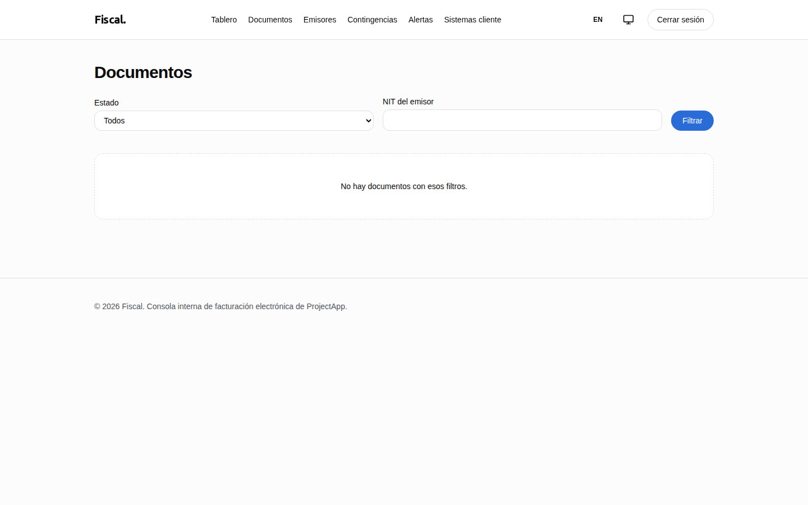 |

## 6. Detalle del documento

**Para qué:** ver qué pasó con un documento, descargar sus archivos y entender un rechazo. **API:**
`GET /api/console/documents/{id}/`, `GET …/artifacts/{kind}/`.

| Bloque | Contenido |
|---|---|
| Volver | «← Volver a documentos» |
| Encabezado | Número completo (monoespaciado, 3xl) y etiqueta de estado |
| Datos del documento | Tipo · Estado · Emisor y NIT · Sistema cliente · Intentos · Clave de idempotencia · Emitido · Creado · Validado; si aplica: documento original (en notas), tipo de factura DIAN (01 venta, 03 transcripción, 04 contingencia DIAN), en contingencia desde, CUFE (cadena larga partida) y «Ver código QR» (abre la DIAN) |
| Errores de la DIAN | Lista: rechazos en rojo, notificaciones en gris con el prefijo «Notificación:»; o «La DIAN no reportó errores.» |
| Artefactos | Tabla: Tipo (XML firmado, Respuesta DIAN, AttachedDocument, PDF, Evidencia) · Tamaño · SHA-256 (abreviado) · Creado · «Descargar»; o «Todavía no hay artefactos.» |
| Historia | Línea de tiempo: etiqueta de estado, fecha y detalle de cada evento |
| Contenido recibido | Desplegable con el JSON crudo que envió el sistema cliente |

- **No encontrado:** «No encontramos ese documento» en recuadro punteado.
- **El estado aparece dos veces:** en la etiqueta del encabezado y en «Datos del documento».
- **«Errores de la DIAN» también muestra notificaciones:** un documento validado aparece con una sección de «errores».
- **En el celular:** los datos quedan en una columna larga, y la tabla de artefactos esconde «Creado» y el botón
  «Descargar».

| Validado (escritorio) | Validado (celular) | Rechazado | No encontrado |
|---|---|---|---|
| 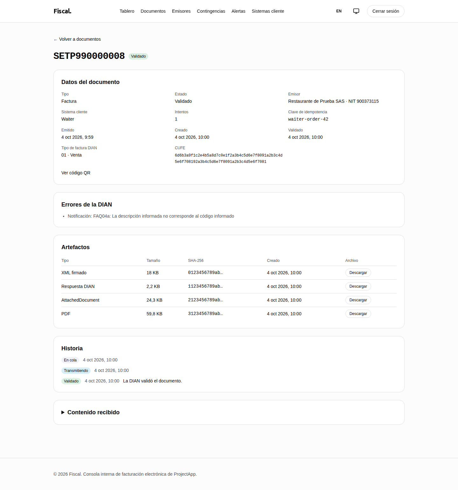 | 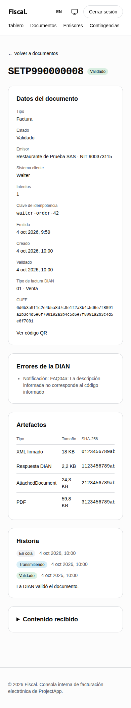 | 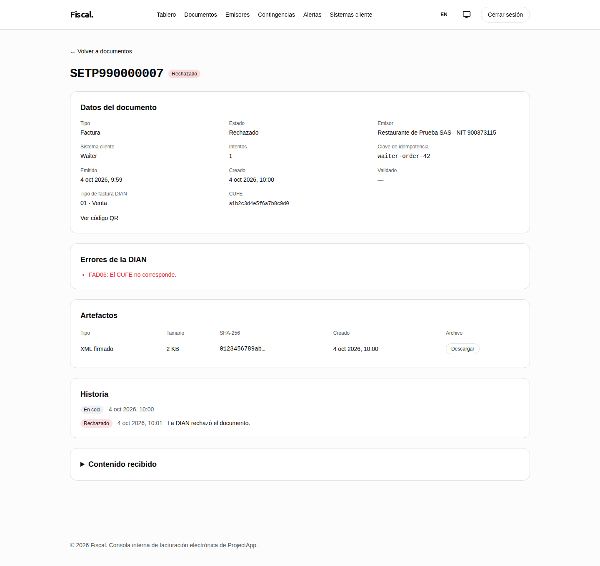 | 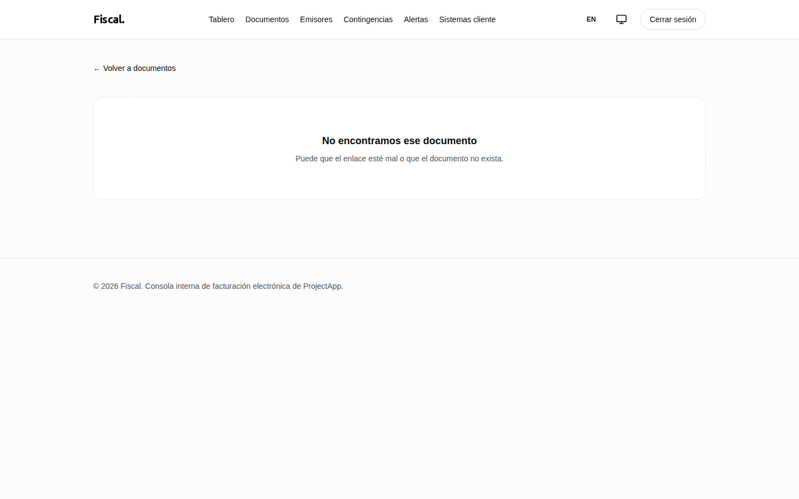 |

## 7. Emisores

**Para qué:** ver los comercios inscritos y entrar a su ficha. **API:** `GET /api/console/issuers/?q=&page=`.

| Elemento | Detalle |
|---|---|
| Encabezado | «Emisores» y botón primario «Inscribir emisor» (único acceso al asistente) |
| Búsqueda | «Buscar por NIT o nombre» y «Buscar» |
| Tabla (6 columnas) | Emisor (nombre como enlace, NIT-DV debajo) · Ambiente (Habilitación o Producción, en texto plano) · Sistema cliente · Documentos · Certificado vence («en N días», rojo a 30 días o menos, «Vencido», «Sin certificado») · Alertas abiertas (rojo si hay) |
| Paginación y vacío | Como en documentos |

| Escritorio | Celular |
|---|---|
| 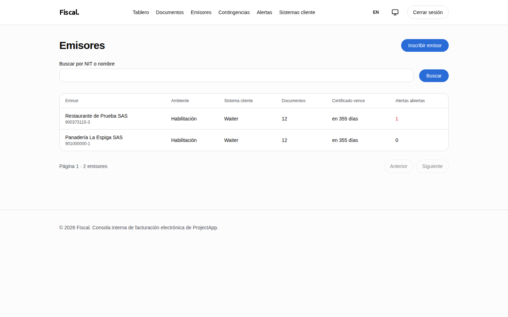 | 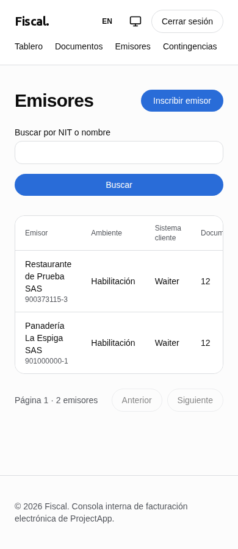 |

## 8. Ficha del emisor

**Para qué:** todo sobre un comercio: datos, certificado, software, numeración, set de pruebas de la DIAN, paso a
producción y carta de contingencia. **API:** `GET /api/console/issuers/{id}/`, `GET|POST …/test-set/`,
`POST /api/console/test-sets/{id}/check/`, `GET …/production/`, `POST …/production/{acción}/`,
`GET …/contingency-letter/?from=&to=`.

Son 8 tarjetas apiladas en una sola columna, en este orden:

| # | Tarjeta | Contenido | Acciones |
|---|---|---|---|
| 1 | Datos del emisor | NIT-DV · Ambiente · Sistema cliente · Tipo de persona · Responsabilidades (códigos) · Correo · Dirección y código DANE | — |
| 2 | Alertas abiertas | Lista «Tipo: mensaje» (rojo si es crítica), con enlace al documento si lo hay; o «Sin alertas abiertas.» | — |
| 3 | Certificados | Tabla: Titular · Emitido por · Vence (fecha y hora) · Estado; o «El emisor no tiene certificados.» en rojo | Ninguna: no se puede cambiar el certificado desde aquí |
| 4 | Software registrado | Tabla: Ambiente · Identificador · Set de pruebas (con o sin TestSetId) · Estado | Ninguna |
| 5 | Rangos de numeración | Tabla: Tipo · Resolución · Números (prefijo y desde–hasta) · Vigencia (fechas ISO: `2019-01-19 → 2030-01-19`) · Usado (%, rojo desde 90 %) · Último número | Ninguna: no se pueden agregar rangos desde aquí |
| 6 | Set de pruebas de la DIAN | Texto de ayuda; «Lo que necesita» (5 requisitos con ✓ verde o ✗ rojo); cantidades de facturas, notas crédito y notas débito; estado de la última corrida con fecha; lo que dice la DIAN de cada lote; tabla Documento · Tipo · Estado · Reglas de la DIAN; o «Todavía no se ha corrido el set.» | «Iniciar set de pruebas» (desactivado si falta algo o hay uno en proceso); «Consultar a la DIAN» (solo en proceso) |
| 7 | Paso a producción | Texto; 5 requisitos con ✓/✗; casilla de confirmación «Confirmo que el comercio ya quedó «Habilitado»…»; o, ya en producción, «En producción: sus documentos tienen efecto fiscal.» en verde | «Usar el software de habilitación», «Traer la numeración de la DIAN», «Pasar a producción» (botón rojo, solo con todo listo y la casilla marcada) |
| 8 | Carta de contingencia a la DIAN | Texto con el correo de la DIAN; fechas Desde y Hasta | «Descargar borrador» (PDF) |

- **No encontrado:** «No encontramos ese emisor».
- **La página es muy larga:** con un set real de 50 documentos pasa de 5.500 px en el escritorio. El set y el paso a
  producción, que son lo que se usa durante la inscripción, quedan al fondo.
- **Fechas:** el vencimiento del certificado sale con hora y en la zona del navegador, así que un certificado que
  vence el 5 de octubre a medianoche UTC aparece como «4 oct 2027, 19:00». Las vigencias de los rangos salen en
  formato ISO. Los campos de fecha de la carta muestran el formato del navegador (`mm/dd/yyyy`).
- **El ambiente no se destaca:** «Habilitación» o «Producción» va en texto plano dentro de los datos, aunque es lo
  más importante de la ficha.

| Con set aceptado (escritorio) | Celular | Falta el TestSetId | Tema oscuro |
|---|---|---|---|
| 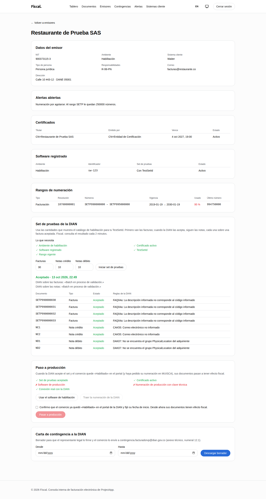 | 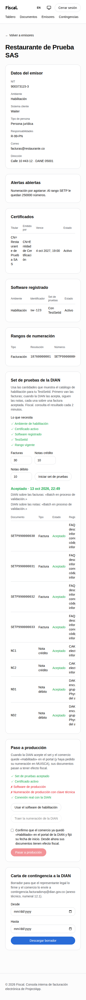 | 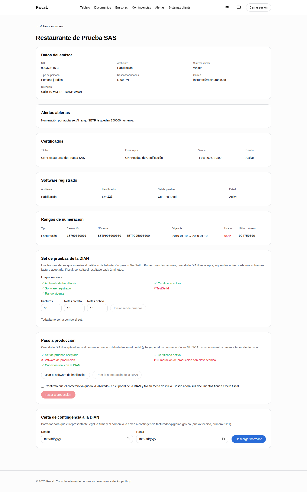 | 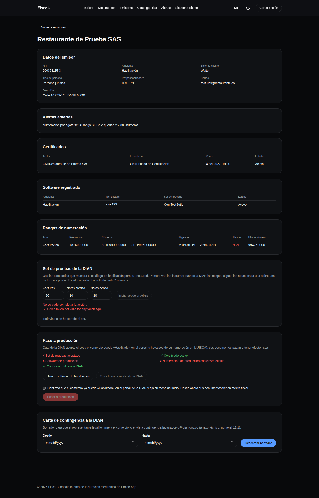 |

No encontrado: [captura](05-consola-vistas/08c-issuer-not-found-desktop.png).

## 9. Inscribir un emisor (asistente)

**Para qué:** dejar un comercio listo para correr el set de pruebas. Queda en habilitación. **API:**
`GET /api/console/client-systems/`, `POST /api/console/client-systems/create/`, `POST /api/console/issuers/create/`,
`POST …/issuers/{id}/certificate/`, `…/software/`, `…/ranges/`.

Encabezado «Inscribir un emisor», el subtítulo y una fila de 5 píldoras: el paso actual en azul, los hechos en verde
claro y los que faltan en gris. Cada paso es una tarjeta con su formulario y el botón «Continuar» («Guardando…»
mientras espera). Los errores del backend salen en rojo sobre el botón.

| Paso | Campos | Notas |
|---|---|---|
| 1 · Sistema cliente | «Sistema cliente existente» (lista) + «Usar este sistema»; «o crea uno nuevo»: nombre y URL de avisos (opcional) + «Crear sistema cliente» | Al crear uno se muestra **una sola vez** el identificador de llave y el secreto, con «Ya lo guardé» |
| 2 · Emisor | NIT (sin DV) · Dígito de verificación · Tipo de persona · Tributo (01 IVA, 04 INC, ZZ no aplica) · Razón social o nombre · Nombre comercial (opcional) · Responsabilidades fiscales (casillas O-13, O-15, O-23, O-47, R-99-PN) · Dirección · Municipio (código DANE de 5 dígitos) · Correo para facturación · Teléfono (opcional) | Las responsabilidades solo muestran el código, sin el nombre. El municipio se escribe a mano |
| 3 · Certificado | «¿Cómo te entregaron el certificado?»: archivo `.p12`/`.pfx` + contraseña, **o** certificado + llave privada + contraseña de la llave (opcional) | Al cargarlo: «Certificado de {titular}, vence el {fecha}» en verde, y aviso si la cadena quedó incompleta |
| 4 · Software | Identificador del software · PIN (oculto) · TestSetId | — |
| 5 · Numeración | Resolución · Prefijo · Desde · Hasta · Vigente desde · Vigente hasta (precargados con SETP 990000000–995000000) · Clave técnica | El texto dice «catálogo de participantes», pero en el portal la página se llama «Set de pruebas Factura Electrónica» |
| Fin | «Emisor inscrito», «Ya puede correr el set de pruebas desde su ficha.» y «Ir a la ficha del emisor» | — |

- **No hay botón para volver** a un paso anterior.
- **El progreso no se guarda:** si se recarga la página, se vuelve al paso 1 y el emisor queda inscrito a medias.
- **No está en el menú:** solo se llega desde el botón de Emisores.

| Paso 1 | Secreto | Paso 2 | Paso 3 (.p12) |
|---|---|---|---|
| 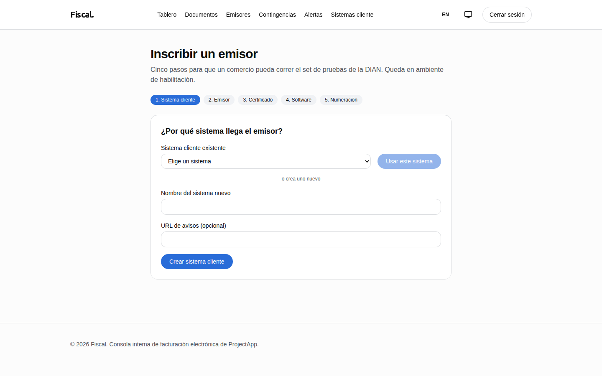 | 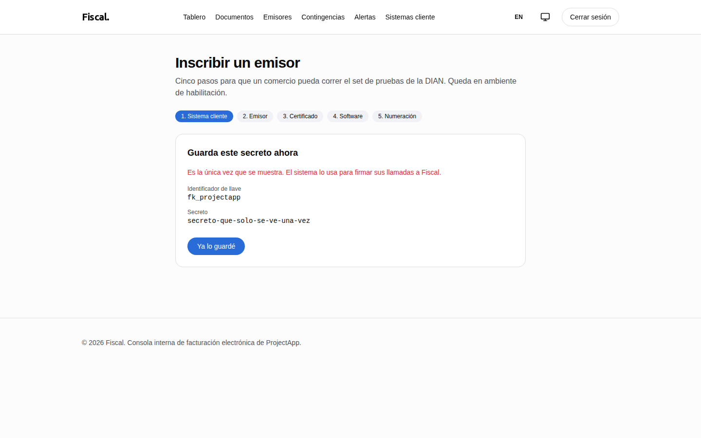 | 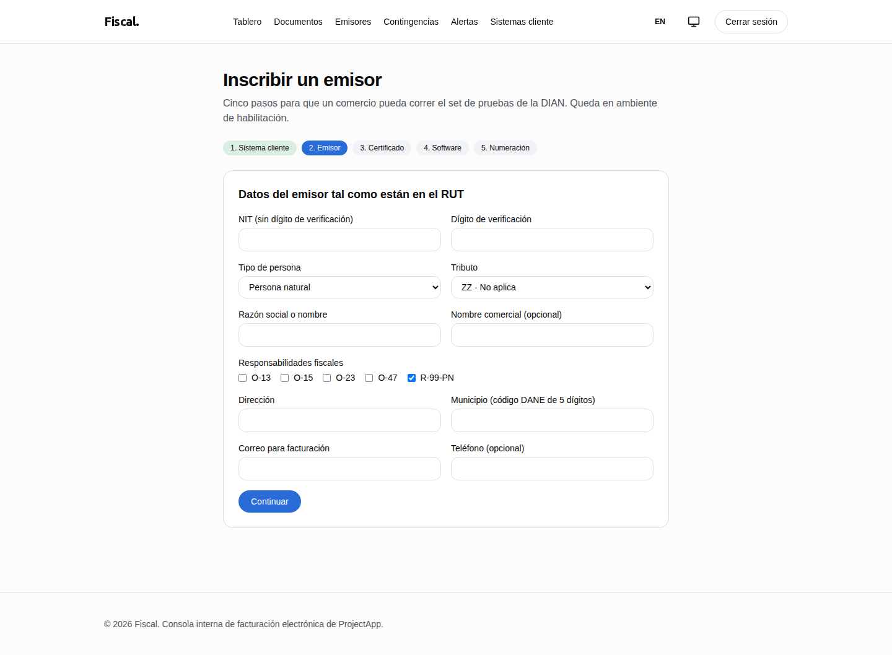 | 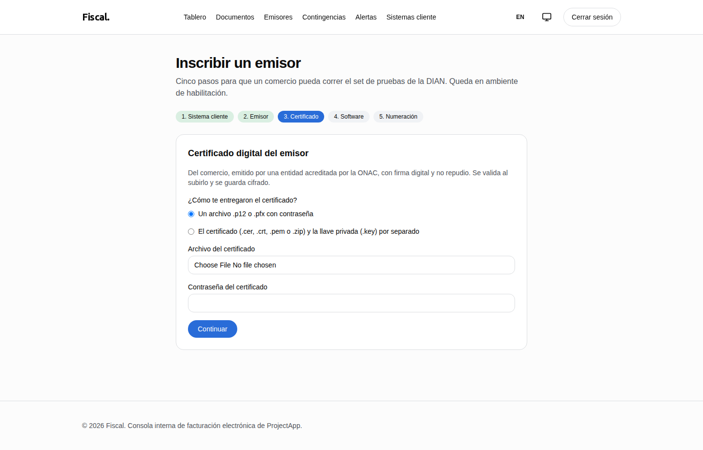 |

| Paso 3 (por separado) | Certificado cargado | Paso 4 | Paso 5 | Fin |
|---|---|---|---|---|
| 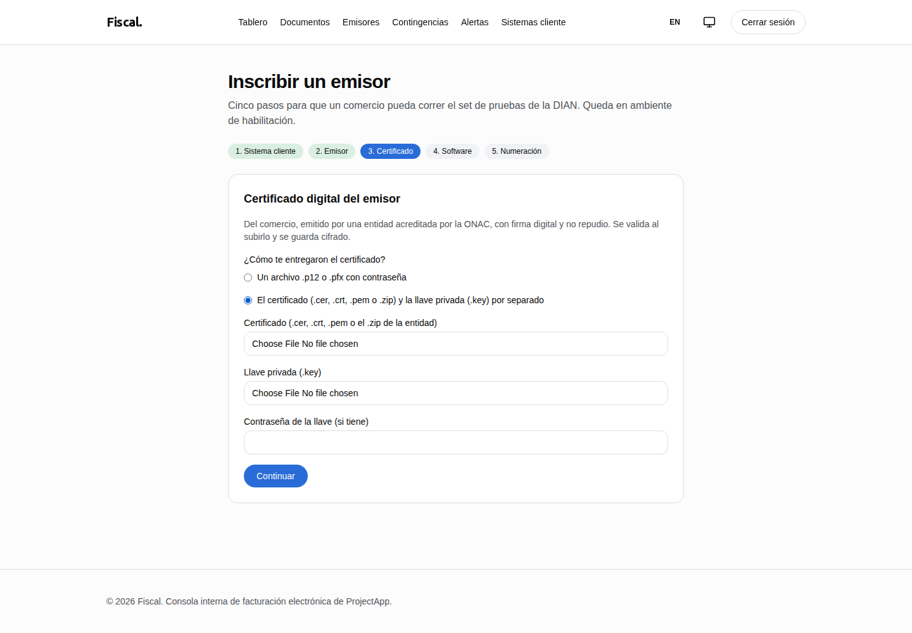 | 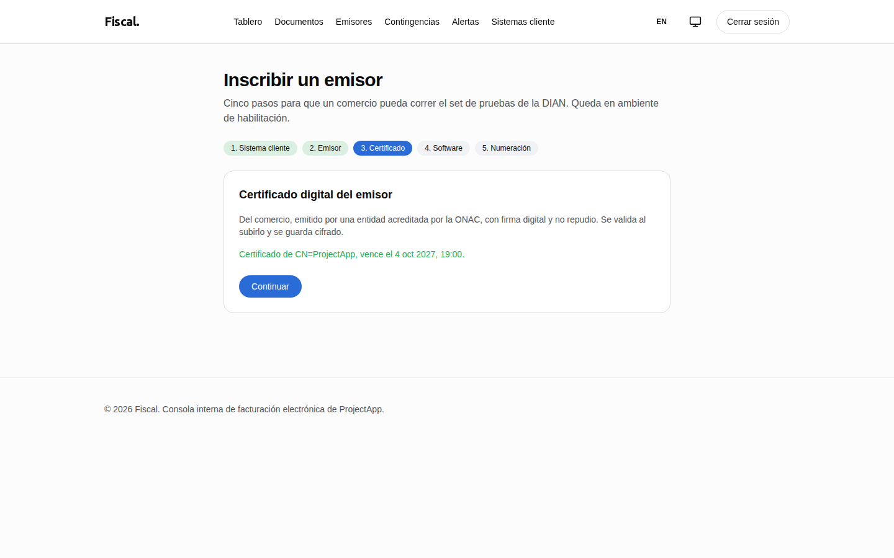 | 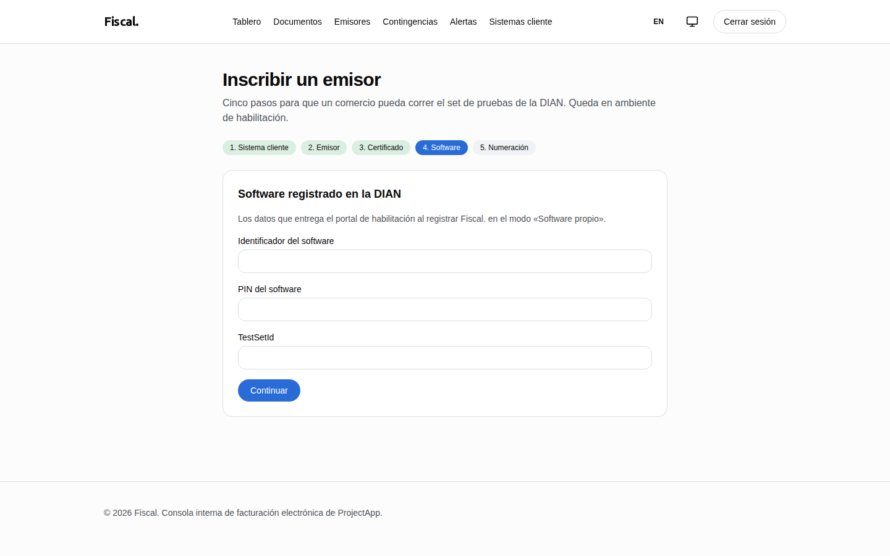 | 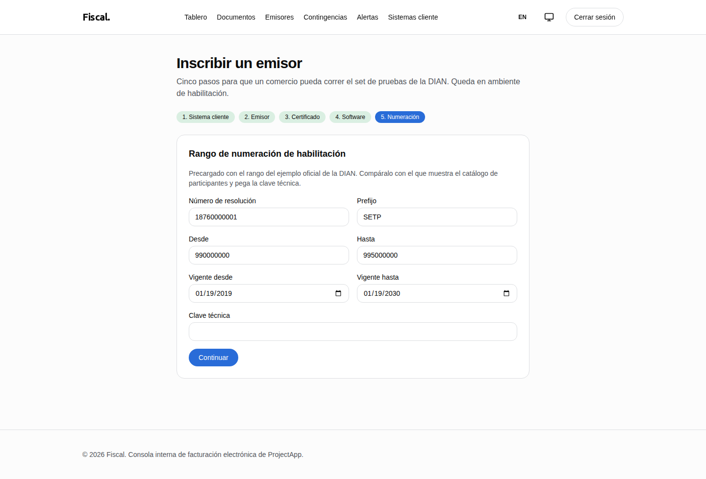 | 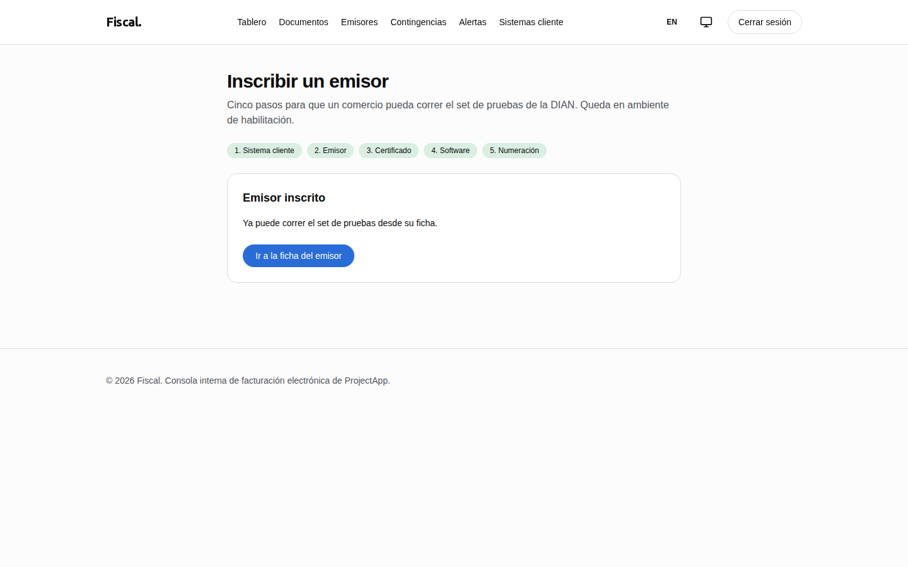 |

Cada paso tiene también su captura en celular (`*-mobile.png`).

## 10. Contingencias

**Para qué:** vigilar las facturas que esperan a la DIAN y su plazo de 48 horas. **API:** `GET /api/console/contingencies/`.

| Elemento | Detalle |
|---|---|
| Encabezado | «Contingencias» y «Facturas que esperan a la DIAN. El plazo para transmitirlas es de 48 horas.» |
| Tabla (7 columnas) | Factura (enlace) · Emisor y NIT · Contingencia («DIAN (tipo 04)» o «Del emisor (tipo 03)») · Desde · Plazo · Tiempo restante («N h»; en rojo y negrilla a menos de 8 h; «Vencido hace N h») · Intentos |
| Vacío | «No hay facturas en contingencia.» |

No tiene paginación ni filtros.

| Con datos | Celular | Vacío |
|---|---|---|
| 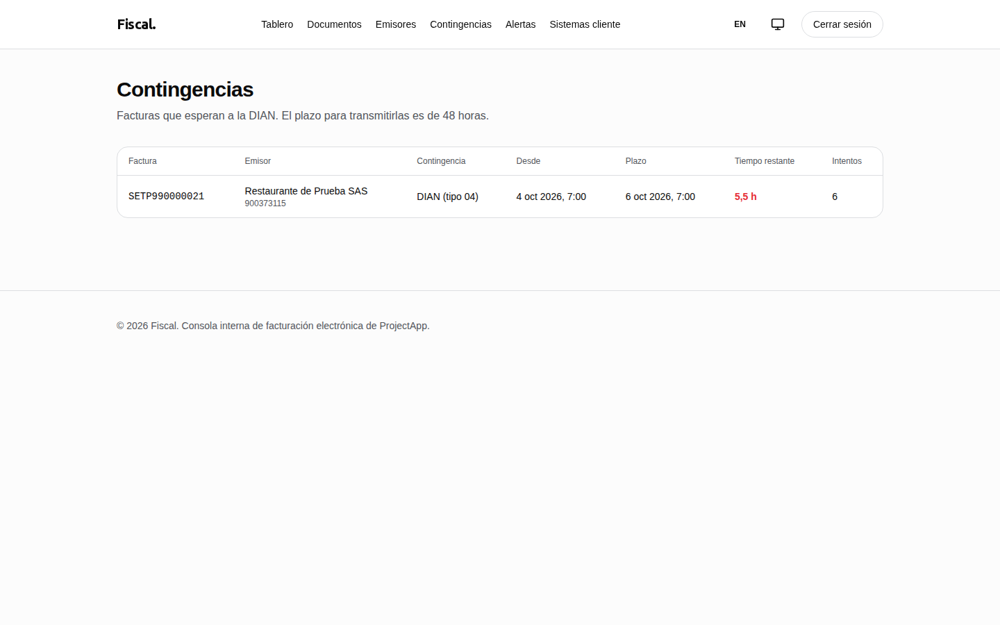 | 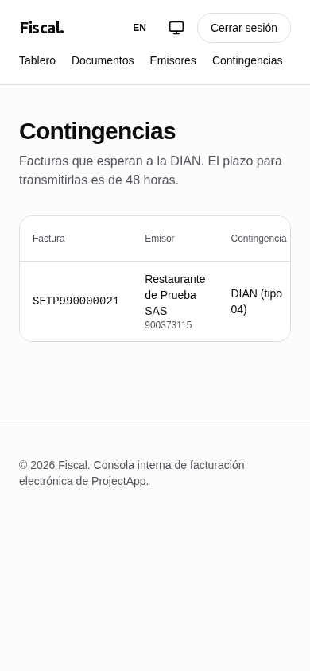 | 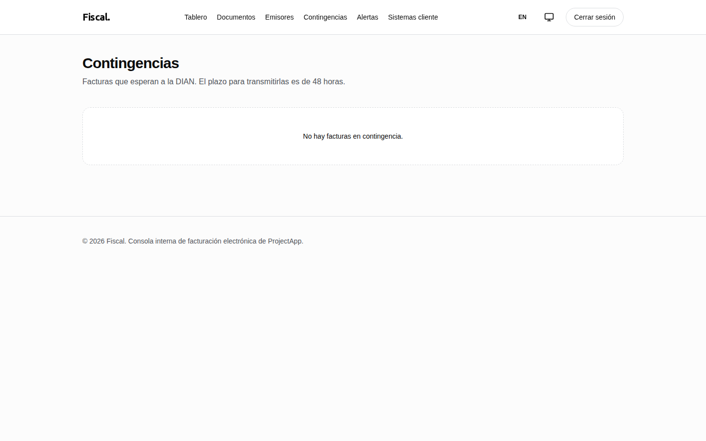 |

## 11. Alertas

**Para qué:** atender lo que exige acción (certificado por vencer, numeración por agotarse, resolución por vencer,
plazo de contingencia, rechazo, cola detenida). **API:** `GET /api/console/alerts/?state=all&page=`,
`POST /api/console/alerts/{id}/resolve/`.

| Elemento | Detalle |
|---|---|
| Encabezado | «Alertas» y casilla «Mostrar también las resueltas» |
| Tabla (6 columnas) | Severidad (etiqueta de color: «Crítica» en rojo claro, «Advertencia») · Tipo · Mensaje (con enlace al documento si lo hay) · Emisor (o «Todo el servicio») · Creada · Acción: «Resolver», o «Resuelta el {fecha}» |
| Paginación | Como en documentos |
| Vacío | «No hay alertas abiertas.» o «No hay alertas.» |

| Con datos | Celular | Vacío |
|---|---|---|
| 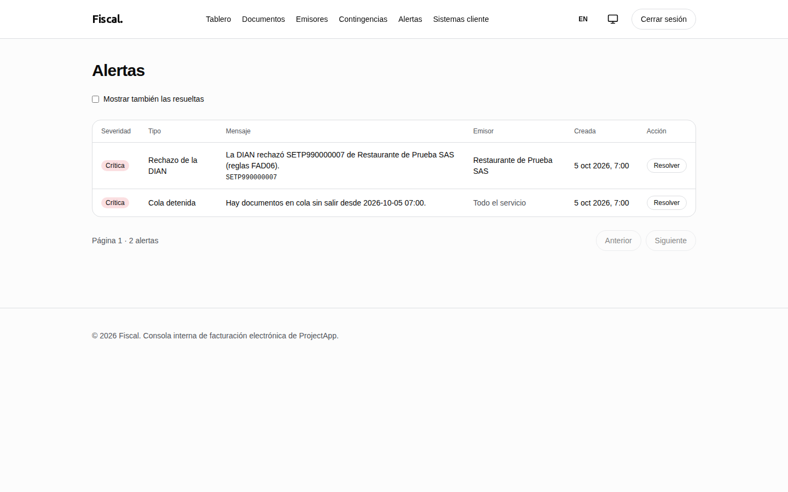 | 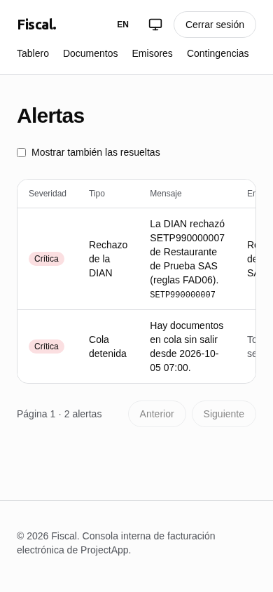 | 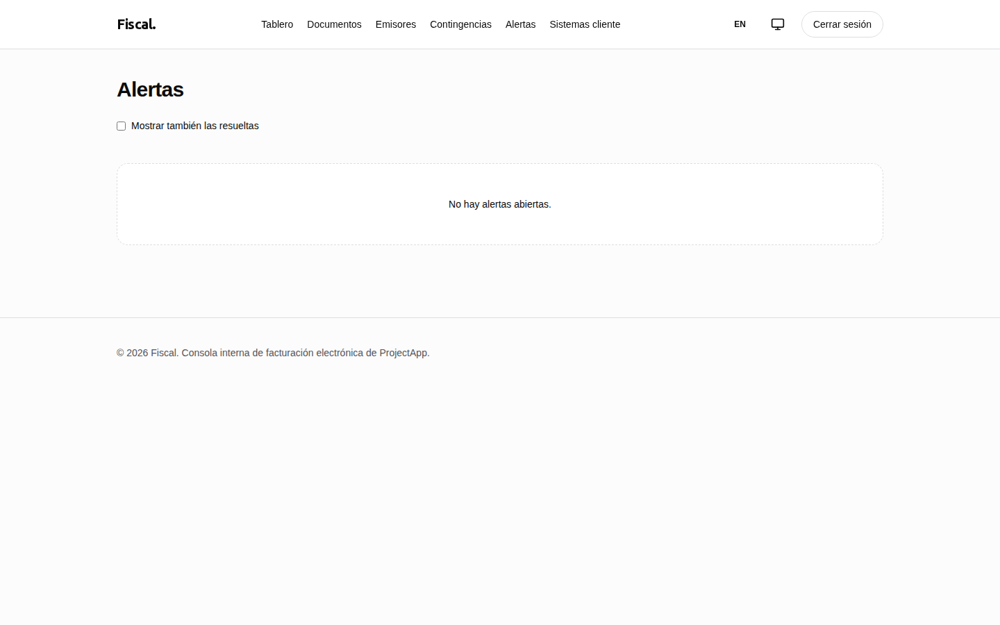 |

## 12. Sistemas cliente

**Para qué:** ver los sistemas que usan la API (Waiter) y el estado de sus avisos. **API:** `GET /api/console/client-systems/`.

| Elemento | Detalle |
|---|---|
| Tabla (7 columnas) | Sistema (y «Inactivo» si aplica) · Identificador de llave (monoespaciado) · URL de avisos (o «Sin URL de avisos») · Secretos vigentes (rojo si es 0) · Emisores · Avisos («N pendientes · M fallidos», rojo si hay fallidos) · Último aviso entregado |
| Vacío | «No hay sistemas cliente.» |

Es de solo lectura: crear un sistema solo se puede desde el asistente, y rotar el secreto, por consola de comandos.

| Escritorio | Celular |
|---|---|
| 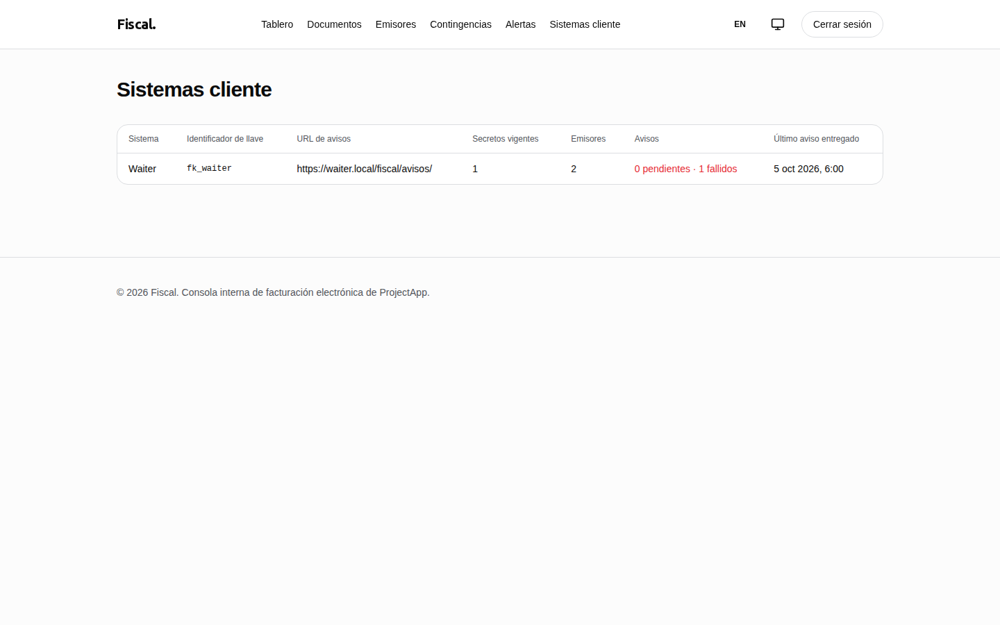 | 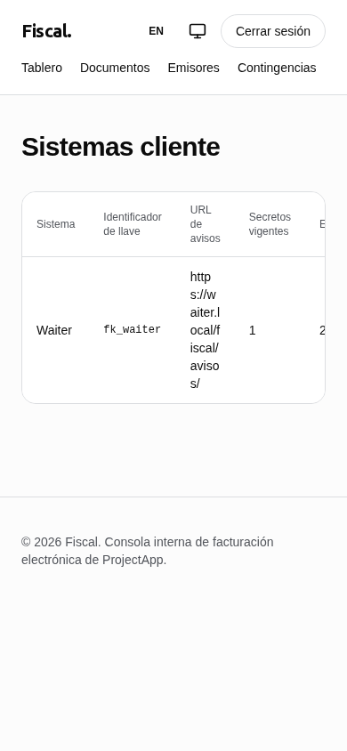 |

---

## Componentes que se repiten

No hay una carpeta de componentes base (`components/ui/`): cada página define sus clases. Esto es lo que habría que
volver componente:

| Componente | Dónde aparece hoy | Variantes que se ven |
|---|---|---|
| Botón | Todas las vistas | Primario relleno (azul), contorno (gris), pequeño de tabla, destructivo (paso a producción); siempre en píldora |
| Campo de texto, lista, fecha, archivo | Acceso, filtros, búsqueda, asistente, carta, set | Dos formas de esquina (acceso vs. resto); etiqueta visible o solo de ayuda |
| Tarjeta | Tablero, detalles, asistente, paneles | Normal; punteada para vacío y no encontrado; roja para error |
| Tabla | Documentos, emisores, contingencias, alertas, sistemas cliente, y 5 tablas dentro de los detalles | Con marco (listas) y sin marco (dentro de tarjetas). Se define de nuevo en cada página |
| Dato con etiqueta | Tablero, detalle del documento, ficha del emisor | Contador grande (tablero) y dato normal (detalles) |
| Etiqueta de estado | Documentos, detalle, historia, alertas | Estados de documento y severidad de alertas, cada una con su código; ambiente y estado del set van como texto |
| Lista de requisitos ✓/✗ | Set de pruebas, paso a producción | — |
| Paginación | Documentos, emisores, alertas | — |
| Estados de carga, vacío, error y no encontrado | Todas las vistas con datos | Carga solo en texto, sin esqueletos |
| Encabezado de página | Todas | Título 3xl, salvo el tablero (logo 4xl) y los estados de no encontrado (lg) |

## Problemas de diseño, por impacto

1. **No hay sistema de componentes.** Faltan los componentes de la tabla anterior: cada página repite sus clases. Por
   eso hay diferencias como los campos de restablecer contraseña. *Todas las vistas.*
2. **No hay identidad de marca más allá del logo.** Los colores son los de la plantilla y no hay paleta definida
   para Fiscal. *`app/globals.css`.*
3. **La ficha del emisor no muestra el ciclo de vida.** Son 8 tarjetas en una columna, el ambiente va en texto
   plano y el set y el paso a producción quedan al fondo. Propuesta: encabezado con el ambiente destacado y una
   línea de progreso (inscrito → set aceptado → habilitado → producción), y el resto en pestañas
   (Resumen · Habilitación · Numeración y certificados · Contingencia). *Vista 8.*
4. **Las tablas no funcionan en el celular.** Se desplazan de lado y esconden columnas clave: el estado en
   documentos, «Descargar» en artefactos. Conviene pasarlas a tarjetas por fila en pantallas angostas. *Vistas 5, 6, 7,
   10, 11, 12.*
5. **Al menú le faltan cosas.** No marca la página activa, en el celular esconde Alertas y Sistemas cliente, no
   incluye «Inscribir emisor» y no muestra quién está conectado. *Marco común.*
6. **Las fechas no son consistentes.** Hay fechas con hora donde solo importa el día (certificado), con desfase por
   zona horaria, fechas en ISO (rangos) y campos de fecha en el formato del navegador. *Vistas 8 y 9.*
7. **El estado no se ve de un vistazo.** El ambiente del emisor (Habilitación o Producción) y el estado del set van
   en texto, sin etiqueta de color. Hay etiquetas para el estado de los documentos y la severidad de las alertas, pero
   cada una con su propio estilo. *Vistas 7 y 8.*
8. **Faltan cosas en el asistente:** volver al paso anterior, guardar el progreso, buscar el municipio por nombre,
   mostrar el nombre de cada responsabilidad y corregir el texto del paso 5. *Vista 9.*
9. **Lecturas confusas.**
   - «Errores de la DIAN» lista también notificaciones.
   - El estado del documento sale dos veces.
   - La tabla del set repite el mismo mensaje en cada fila (en el set real, 30 veces FAQ04a); podría agruparse por
     regla.
   - El CUFE no tiene botón de copiar.
   - El contenido recibido es JSON crudo.

   *Vistas 6 y 8.*
10. **Faltan acciones en la ficha del emisor.** No se puede reemplazar el certificado, agregar un rango ni editar los
    datos después de la inscripción. Hoy solo se puede por la API. *Vista 8.*
11. **La carga es solo texto.** «Cargando…» sin esqueletos, y la página salta cuando llegan los datos. *Todas.*
12. **Quedan restos de la plantilla.**
    - El botón «Iniciar sesión» del encabezado aparece en la propia página de ingreso.
    - La 404 es la de Next.js.
    - `globals.css` tiene animaciones que no se usan (`bounce-slow`, `delay-*`).

    *Marco común.*

## Cómo volver a tomar las capturas

Las capturas salen de un script de Playwright que usa los datos de ejemplo de `frontend/e2e/fixtures.ts`. No toca el
backend y no se guarda en el repositorio. Se corre contra `next dev` en `:3012` con la imagen
`mcr.microsoft.com/playwright:v1.62.1-noble` (`--network host`). Si se rediseña, conviene versionar ese script en
`frontend/e2e/` como prueba visual.
